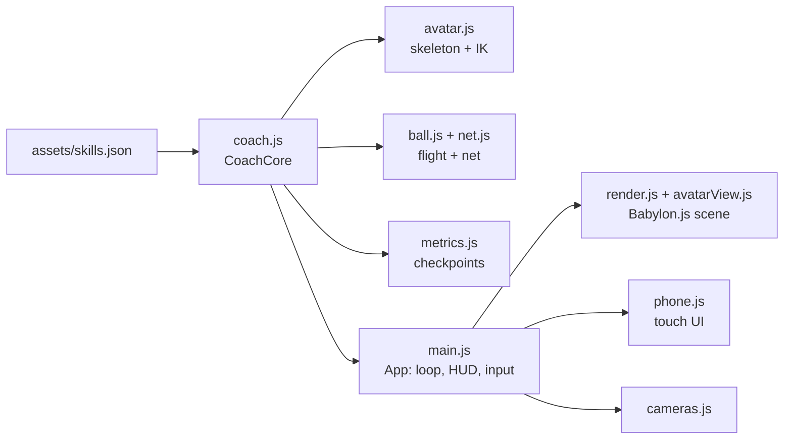

<div align="center">

# 🏀 HoopForm Web

**Step-by-step 3D basketball coaching for junior players, right in the browser.**

A FIBA arena, a coaching avatar and phase-by-phase biomechanics for the
**free throw**, the **three-pointer** and the **layup**. No install, no build step.


</div>

<!-- Add a screenshot or GIF here once you have one, e.g.:
<p align="center"></p>
-->

## Contents

- [Features](#features)
- [Quick start](#quick-start)
- [Controls](#controls)
- [Using it on a phone](#using-it-on-a-phone)
- [Using it in VR](#using-it-in-vr)
- [Settings and performance](#settings-and-performance)
- [Deploy to GitHub Pages](#deploy-to-github-pages)
- [How it is built](#how-it-is-built)
- [Editing coaching content](#editing-coaching-content)
- [Testing](#testing)
- [Browser support](#browser-support)
- [Third-party software](#third-party-software)

## Features

- **Three skills**: free throw (B.E.E.F: Balance, Eyes, Elbow, Follow-through), three-pointer and running layup.
- **Phase-by-phase coaching**: every phase has cues, the reason behind them, live checkpoint measurements,
  common faults with their fixes, and one short drill.
- **Full 3D arena**: FIBA court with painted lines, a two-tier stadium, reflective floor and hoops with a simulated net,
  tempered-glass backboard and portable stanchions.
- **A fully procedural player**: one skinned body with jersey, shorts, socks and sneakers, a sculpted head,
  and IK-driven hands. Height, handedness and ball size are adjustable.
- **Four camera modes**: Auto (each phase picks a view), Third person, First person (the player's eyes) and
  a walk-around Coach view at junior eye height.
- **Shot readout**: launch angle, entry angle and arc, with ideal-path and acceptable-band guides.
- **Slow motion** from 0.1× to 1×, step through phases, left- and right-handed shooters.
- **Phone friendly**: touch controls, a swipeable coaching sheet, tilt-to-look, wake lock and an automatic lite mode.
- **Installable and offline**: add it to the home screen; a service worker caches the app after the first visit.

## Quick start

There is nothing to build. Any static file server works (ES modules do not load from `file://`).

```bash
git clone <this-repo-url> hoopform-web
cd hoopform-web
python -m http.server 8000
# open http://localhost:8000
```

On Windows, double-click `run.bat`: it starts the same server on port 8010 and opens the browser.

The first load needs internet access because Babylon.js is loaded from the jsDelivr CDN
(see [Third-party software](#third-party-software)). After that the service worker keeps a cached copy for offline use.

Add `#webgpu` to the URL (or use *Settings → Try WebGPU*) to try the WebGPU renderer;
it falls back to WebGL2 automatically. Press **?** in the app for the in-app shortcut list. Run the tests with `npm test` (see [Testing](#testing)).

## Controls

### Desktop

| Key / mouse | Action |
|---|---|
| `Space` | Play the whole skill on repeat / pause |
| `→` or `D` / `←` | Play the next phase and stop / go back one phase |
| `K` | Next skill: free throw → three-pointer → layup |
| `+` / `−` | Playback speed, 0.1×–1× |
| `1`–`4`, `C` | Cameras: Auto · Third person · First person · Coach view; `C` cycles |
| drag, wheel, `Q` / `E`, `[` `]` | Orbit, zoom, field of view |
| `H` | Switch between left- and right-handed shooter |
| `A`, `L`, `T`, `R` | Toggle angle protractors · shooting line · ball trail; restart |
| `?` | Show the shortcut list |

### Camera modes

| Mode | Behaviour |
|---|---|
| **Auto** | Each phase picks a view. Just before release the camera swings over the shooting shoulder so the hand, head, arc and ring all fit. Turning the view hands control to Third person. |
| **Third person** | Orbit camera that keeps your angle and distance while following the player. |
| **First person** | The player's eyes, following the head as it tracks the rim. Drag to look around, wheel or pinch for field of view. Overlays are hidden. |
| **Coach view** (`F` or `4`) | Walk the court at the junior's eye height. |

**Coach view controls**: `WASD` run, `Shift` walk, right-click jump, `Ctrl` crouch, inverted-Y mouse look
(click the view to capture the mouse), `N` noclip (right-click/`E` up, `Ctrl`/`Q` down), wheel for FOV, `F` or `Esc` to exit.
On touch: left stick, drag to look, and JUMP / CROUCH / NOCLIP / FOV buttons.

## Using it on a phone

- Drag one finger on the court to turn the camera, tap to play or pause, pinch to zoom.
- The playback bar is ⏮ ▶/⏸ ⏭ plus a Speed button; the **⋯** menu holds speed, cameras, display toggles,
  handedness, settings, Coach view (with look speed and tilt-to-look) and full screen.
- Held upright, the coaching panel shows the title plus one section at a time (Cues, Why, Checks, Faults, Drill).
  Swipe sideways or tap the tabs. Drag the handle to fold it; it folds itself while a loop plays.
  Sideways, coaching is an overlay you can hide.
- A short tour runs on the first visit.

## Using it in VR

Where the browser offers an immersive VR session (Meta Quest Browser, desktop Chrome/Edge with a headset, or the
Immersive Web Emulator extension) a **Switch to VR** button appears at the top. **WebXR needs HTTPS or `localhost`**:
open the GitHub Pages copy in the headset, or forward a port (`adb reverse tcp:8000 tcp:8000`, then browse to
`http://localhost:8000`). It uses WebGL2 (if you opened `#webgpu`, the button reloads without it).

You stand in the arena at real size, so the 1.6 m player is a real person next to you. Everything on the phone is there:

| Phone | VR |
|---|---|
| Tap = play / pause | **A** (right) |
| ⏮ / ⏭ phase | **X** (left) / **B** (right) |
| Speed | right thumbstick up / down, or the panel |
| Turn | right thumbstick left / right (45° snap turns) |
| Coaching sheet, timeline, skill, handedness, toggles | the panel floats above the **left** controller: point the **right** controller at it and pull the trigger. **Y** (left) shows or hides it. A beam from the right controller ends in a ring where it lands on the panel (the ring shrinks while the trigger is held). **Exit VR** is on every tab (bottom right); squeezing **both grips for a second** leaves VR even when the panel is hidden. With no left controller tracked it floats in front of you instead |
| Cameras | **Spots** tab: viewpoints around the player (Coach, Side, Front, Behind, Hands, Over shoulder, Wide) |
| Walk around | **Teleport**: push the left thumbstick forward, aim the arc, let go. Also the court spots in the **Spots** tab: free-throw line, three-point top / wing / corner, under the basket, courtside |
| Angles, line, trail | **More** tab. Joint angles and the shot readout become 3D labels |

Controllers without A / B / X / Y use the grip button (right = play, left = panel). **Follow the player** snaps you back
to the same viewpoint when the player runs off (the layup), instead of moving the camera smoothly, which causes motion sickness.
Rim height, shadows, crowd and lite mode rebuild the scene and stay outside VR. To keep frame rate up in the headset the
floor reflection is off and the far upper seats are hidden. Controller models load from the WebXR input-profiles CDN (jsDelivr).

## Settings and performance

**Settings (⚙)**: player height, rim height, ball size 5/6/7, release angle, shadows, reflections, stands.
They are remembered in the browser (`localStorage`).

**Sound** (the **Sound** button under ⋯, or **M**): a swish as the ball drops through the net and a bounce for every dribble and floor bounce, placed in 3D around the camera (your head in VR). They are synthesized in code, so there are no audio files. They play only while time runs on by itself, so scrubbing stays quiet, and the browser only starts audio after your first tap, click or key press (if it is still blocked when a sound is due, a message says so; turning Sound on plays a short confirmation bounce). If you hear nothing on a PC, check the tab is not muted (right-click the tab), the site's Sound permission is Allow (padlock › Site settings), and hard-reload (Ctrl+Shift+R) so the latest files load; `hoopform.sfx.state` in the console should read `running`.

**Lite mode** (Auto / On / Off) drops reflections, the upper-tier seats and shadow resolution. On Auto it switches
itself on if the frame rate stays under 30 fps. You can force it with `?lite=on` or `?lite=off` in the URL.
The screen stays awake while playing and drawing stops when the page is hidden.

## Deploy to GitHub Pages

The site is plain static files with relative paths, so it works from a repository sub-path as-is:

1. Push the repository to GitHub.
2. Go to **Settings → Pages**, set the source to *Deploy from a branch*, pick your default branch and the `/ (root)` folder.
3. Open `https://<user>.github.io/<repo>/`.

Pages serves over HTTPS, which the service worker and "add to home screen" need.

## How it is built



The coaching maths is **headless** (no Babylon.js in `coach.js`, `avatar.js`, `ball.js`, `gait.js`, `metrics.js`),
so the same skeleton drives both the checkpoints and the rendered body.

```
index.html          page, HUD styles and layout (desktop / phone portrait / phone landscape)
manifest.json, sw.js, icons/   home-screen install and offline support
run.bat             Windows helper: local server on port 8010 + opens the browser
THIRD_PARTY_LICENSES.md        licenses and notices for third-party software
tests/              automated tests (Node's built-in runner, no dependencies): see "Testing"
.github/workflows/  CI: runs the tests on every push and pull request
src/main.js         app: game loop, HUD, input, playback, camera framing
src/render.js       Babylon.js: engine, lights + shadows, arena, reflective floor, ball, net, overlays
src/court.js        painted maple court surface + every FIBA line as vector geometry
src/stadium.js      empty two-tier arena bowl: seats (thin instances), stairs, rails, suites, LED ribbon
src/body.js         avatar surface: skinned body + clothing, sculpted head, hands, sneakers (bind pose)
src/avatarView.js   avatar rendering: Babylon skeleton driven by the joints, materials, painted textures
src/cameras.js      camera modes, coaching presets with auto-fit (used by Auto), walk-around coach view
src/phone.js        touch UI: coaching sheet, options sheet, tour, floating joystick, tilt, wake lock
src/vr.js           VR (WebXR): session, controllers, teleport, 3D labels, quality switches
src/vrPanel.js      the floating VR coaching panel (a canvas texture on a plane)
src/vrPointer.js    the right controller's beam and the ring where it lands on the panel
src/sfx.js          sound effects: Web Audio player, placed in 3D around the camera / your head
src/sfxSynth.js     headless: the swish and the bounce, synthesized as samples (no audio files)
src/vrmath.js       headless VR maths: viewpoints and court spots, walk clamp, panel layout and hit-testing, thumbstick edges
src/coach.js        headless coaching core (port of the Python Coach): timeline, footwork, ball
src/avatar.js       skeleton, IK (guide hand: damped least squares), arm/torso clearance
src/gait.js         run-in gait for the layup (speed profile, flights, footprints)
src/ball.js         ball flight: launch solve, bank shots, swish, net drag, floor bounces
src/net.js          hoop net simulation (Verlet + constraints)
src/animation.js    monotone cubic keyframe timeline, left-handed mirroring
src/metrics.js      the live checkpoint metrics
src/math.js, geometry.js, config.js
assets/             skills.json, court and ball textures (exported from Python)
```

**Conventions**: units are metres and degrees; the coordinate system is left-handed like Babylon.js
(+X to the shooter's right, +Y up, +Z toward the basket).

### The avatar

The player is one continuous skinned body (torso, arms and legs bend smoothly at the elbows, knees, hips and spine)
wearing skinned clothing: a tank-top jersey with trimmed armholes and numbers, loose shorts with side stripes, crew socks
and high-top sneakers. The head is sculpted (jaw, cheekbones, brow, nose, lips, eye sockets) with eyelids, irises, ears and a
short haircut. Everything is generated in code from the same skeleton the coaching maths uses, so the motion and every
checkpoint are unchanged; only the surface that follows the skeleton is new.

### Relationship to the Python app

HoopForm began as a Python (Ursina/Panda3D) authoring tool. The JS core is a straight port and was checked numerically
against it (end times and release angles match; joints agree to well under 1 mm except where the guide-hand IK picks an
equally valid solution). **The Python app is no longer updated**, and the web version has since diverged (below).

<details>
<summary><strong>Web-only changes since the port</strong> (click to expand)</summary>

- *Throwing release* (`CoachCore._retimeRelease`). For the last 0.12 s before release the shooting
  arm follows a solved path instead of the authored keys: the hand runs on a smooth curve into the
  release point at a real throwing speed, and the shoulder and elbow are solved by IK to follow it.
  Joint speeds are capped at realistic peaks (elbow ~1200-1250°/s, shoulder ~700-770°/s), and a
  short fingertip roll-off adds the rest of the launch speed. The release is earlier
  (`release_fraction` 0.40 for the free throw and the three, −0.5 for the layup, i.e. late in the
  jump), so the ball leaves while the elbow is still opening (about 127° on shots and 140° on the
  layup) and the elbow finishes straight in the follow-through. The release checkpoints were
  re-ranged to match (115-150° for shots, 125-165° for the layup).
  Re-exporting `skills.json` from Python overwrites these values.
- *Dribble path* (`CoachCore._dribblePath`). Hermite pieces: down from the hand with the hand's
  velocity under gravity plus a steady push; up from the floor at the speed gravity needs to reach the
  hand, arriving with the hand's velocity. The bounce time is chosen per dribble so the ball comes up at
  ~78% of its landing speed (about 5.5 m/s down, 4.4 m/s up), during the LEFT-foot stance.
- *Layup run* (`gait.js`, `CoachCore._dribbleArm/_runArms`, `skills.json` gait spec). The dribbling
  hand rides at waist height in front of the hip, palm down, and pushes the ball forward-down, so
  the bounce is out in front and to the side, clear of the legs (`_clearDribble` models the thigh
  with the loose shorts). The swing foot kicks up behind before coming through, and the free arm
  swings against the legs. The ONE-TWO steps are longer than the running strides (about 1.2 m and
  1.05 m against 0.9 m): each has a longer flight before it, the hips sink a little on ONE, and the
  ONE leg swings through under the hips during TWO before driving up.
  Speed: quick first steps (about 1 m/s after 0.2 s, 2 m/s by 0.45 s) up to 2.75 m/s, so the strides
  open from about 0.35 and 0.8 m to 0.95 m, then 1.26 m (ONE) and 1.09 m (TWO); the start is ~9.6 m out on
  the right wing, inside the sideline.
  Hip heights are set so the legs extend like a runner's: the stance knee lands at about 165-170°,
  bends to about 140-145° mid-stance and straightens to 160-175° at push-off; the ready stance is
  about 130°; the 1-2 still sinks the hips (about 7 cm at the TWO plant) before the jump leg straightens.
- *Hoops* (`render.js buildHoop`). 20 mm ring on a flange plate with two braces and 12 net hooks; the
  net is simulated (`net.js NetSim`): 9 x 24 knots hung from the hooks, joined by the
  diamond cords and soft rings, Verlet + constraints with drag and a light pull back to the hanging
  shape; the ball pushes knots aside and drags them with friction, the bottom opening is a little
  narrower than the ball so it checks it. Stepped in skill time (slow motion slows it), reset on seeks; tempered-glass backboard with green
  edges, an aluminium frame, painted border and shooter's square, padding along the bottom and up the
  sides, and a static reflection probe of the arena (skipped in lite mode); portable stanchion with a
  padded base, padded raked post and a curved boom to a steel frame behind the glass.
- *Shot readout* (`App.updateShotReadout`, `Overlays.setShotReadout`). When a free throw or three goes
  in: a launch-angle wedge at the release point, a small tick at the top of the arc, an entry-angle wedge at the ring, labels on each, and a card with the three numbers
  and a one-line read of the arc. From the release on, light-grey arcs show the ideal path to the
  ring (45° entry) and the acceptable band (38-52° entry) from the same release point (`App.guidePaths`).
  Overlay meshes carry `metadata.noReflect` and stay out of the floor mirror.
- *Camera modes* (`App.setCamMode`): auto, third, first, coach. In Auto, from just before the release the
  camera swings round over the shooting shoulder (`OrbitCam.shotGoal`) at about the usual coaching
  distance, aimed so the release point (hand, `BallPhysics.p0`), the head and shoulders, the arc
  (`apex_y`) and the ring + backboard fit in the free part of the screen; it eases back only if they can't. Turning the Auto view hands it over to
  Third person. First person sits at the eyes and follows the head (which tracks the rim), smoothed;
  overlays (angles, shooting line, joint highlights) are hidden there.
- *Camera* (`OrbitCam.update`). After you turn or zoom the view, the camera keeps your angle and
  distance but its look-at point still follows the player, so the running layup stays centred.
- *Coaching content* (`assets/skills.json`). Every phase has `why`, `cues` (shown first; each fits on one line, even on a small phone held sideways; text before an optional " — " is bold), `faults` written as `"problem → fix"` (the panel
  shows the fix on its own line) and a `drill`: one short practice drill (`"Name: how to do it"`).
  Left-handed players get the same text with left/right swapped (`mirrorText`).

</details>

## Editing coaching content

All coaching text and timing live in `assets/skills.json`, so most content changes need no code.
Each skill has `phases`, and each phase has:

| Field | Meaning |
|---|---|
| `title`, `duration`, `pose` | Name, length in seconds and the key pose |
| `cues` | Shown first; each fits on one line, even on a small phone held sideways. Text before an optional ` — ` is bold. |
| `why` | The reason behind the phase |
| `faults` | Written as `"problem → fix"`; the panel shows the fix on its own line |
| `drill` | One short practice drill, `"Name: how to do it"` |
| `checks`, `focus`, `camera`, `stance`, `arc`, `ball` | Checkpoint ranges, highlighted joints, camera preset, footwork and ball data |

Left-handed players get the same text with left and right swapped automatically (`mirrorText`).

Re-exporting `skills.json` from the Python tool overwrites the web-only changes listed above, so edit the JSON directly instead.

## Testing

The coaching maths is headless, so the tests run in plain Node with **no browser, no install and no dependencies**
(Node 20 or newer, using the built-in `node:test` runner):

```bash
npm test          # or: node --test
```

The suite takes roughly 10-30 s depending on how many CPU cores are available (test files run in parallel).
GitHub Actions runs it on every push and pull request (`.github/workflows/test.yml`).

| Test file | What it protects |
|---|---|
| `skills-content.test.js` | `assets/skills.json`: every phase has `why`, cues (short enough for one line), `"problem → fix"` faults, a `"Name: how"` drill; checkpoints use real metrics with `lo ≤ hi`; camera presets and highlighted joints exist; no mistyped pose channels |
| `shots.test.js` | Every skill scores, for both hands. Free throw and three enter at 38-52° and swish without touching the rim. A sweep over player height, rim height and ball size must still score |
| `checkpoints.test.js` | Every coaching checkpoint is in range at the end of its phase, for both hands; release angle and elbow match the figures in this README |
| `mirroring.test.js` | A left-handed player is an exact mirror of a right-handed one (to 1 mm), and `mirrorText` swaps left and right correctly |
| `body.test.js` | Over a whole playback: limbs keep their length (IK integrity), feet stay above the floor, nothing is NaN, the ball never teleports; where the player stands; the layup run-in speed profile |
| `timeline.test.js` | Keyframe timeline passes through every key and never overshoots; mirroring poses is reversible |
| `sfx.test.js` | sounds: one swish per made shot at the hoop, floor bounces that get quieter, one bounce per dribble; the synthesized sounds are finite, normalised, die away and have the right pitch range; the player against a fake Web Audio API (blocked or suspended context, retry after a failed start, throttle, listener maths) |
| `vr.test.js` | VR maths: every spot is a legal standing point for every skill and hand, viewpoints face the player, the panel layout has no overlapping buttons and every button is reachable, thumbstick edge detection |
| `net.test.js`, `geometry.test.js`, `math.test.js`, `config.test.js` | The net simulation, mesh generators, vector/matrix maths and FIBA dimensions |

**Known issue, tracked as `TODO`.** The off-hand ("guide") arm is solved by IK and is not an exact mirror image
between left- and right-handed players in about 5% of frames (up to roughly 3 cm on the free throw and 10 cm on the layup).
`mirroring.test.js` keeps a loose bound so it cannot get worse, and a strict test marked `todo` that reports as TODO until
this is fixed. When it passes, remove the `todo` option.

**Not covered.** Rendering (Babylon.js meshes, materials, the HUD, touch input and cameras) is not tested automatically;
check those by eye (see *Verifying changes* in `CLAUDE.md`).

When you change coaching content or tuning, run the tests first: a failing checkpoint test usually means a range in
`skills.json` needs to move with the animation (or the other way round).

## Browser support

Any current browser with **WebGL2** (Chrome, Edge, Firefox, Safari 15+, and their mobile versions).
WebGPU is optional. VR needs a WebXR browser (Meta Quest Browser, Chrome or Edge with a headset) over HTTPS or `localhost`. Service-worker install, wake lock and tilt-to-look depend on the browser and on HTTPS.

## Third-party software

The only third-party dependency is [Babylon.js](https://www.babylonjs.com) 9.36.0, licensed under the
Apache License 2.0 and loaded from the jsDelivr CDN rather than copied into this repository.
Its copyright notice and the full license text are in [THIRD_PARTY_LICENSES.md](THIRD_PARTY_LICENSES.md).
If you host a copy of Babylon.js yourself, ship that file with it.

## License

No license has been chosen for HoopForm itself yet. Until one is added, all rights are reserved by the author.
